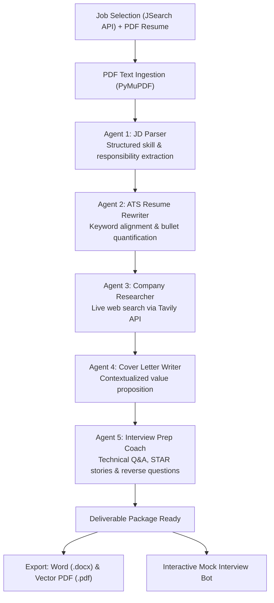

# AI Job Hunter (Jobify)

[](https://www.python.org/)
[](https://fastapi.tiangolo.com/)
[](https://langchain-ai.github.io/langgraph/)
[](https://react.dev/)
[](https://vitejs.dev/)
[](https://tailwindcss.com/)
[](LICENSE)

An autonomous multi-agent application pipeline that sources live job listings, parses raw candidate resumes, and synthesizes tailored, ATS-compliant application deliverables—including formatted Word and PDF resumes, targeted cover letters, company research dossiers, and an interactive mock interview coach.

---

## System Overview

AI Job Hunter replaces repetitive manual job customization with an orchestrated graph of specialized language agents. When a candidate selects an active listing and uploads their existing PDF resume, the system executes an automated workflow:

1. **Job Ingestion & Parsing**: Normalizes role requirements, tech stacks, and domain expectations from live aggregator data.
2. **ATS Alignment**: Rewrites candidate achievements using relevant keywords from the job description without fabricating experience.
3. **Web Grounding**: Queries live web sources for company mission, work culture, and recent news.
4. **Application Synthesis**: Generates targeted cover letters and interview prep guides tailored to the candidate's actual projects.
5. **Document Export Engine**: Renders and exports native Microsoft Word (`.docx`) and vector PDF (`.pdf`) documents directly from the browser.
6. **Live Mock Interview**: Simulates an interactive interview with automated scoring and constructive feedback across 5 technical/behavioral rounds.

---

## Architecture & Data Flow

The core pipeline is built on **LangGraph**, passing an immutable typed state dictionary (`AgentState`) through sequential transformation nodes:



### Agent Pipeline Breakdown

| Agent | Module | Input | Output / Responsibility |
|---|---|---|---|
| **JD Parser** | `agents/jd_parser.py` | Raw JD text, title, company | Normalizes core responsibilities, tech stack, and role titles into structured JSON. |
| **Resume Rewriter** | `agents/resume_rewriter.py` | Parsed JD + candidate resume text | Maps candidate experience to JD keywords; outputs ATS-compliant Markdown structure. |
| **Company Researcher** | `agents/company_researcher.py` | Company name, role context | Executes multi-query Tavily web searches; distills mission, products, and culture. |
| **Cover Letter Writer** | `agents/cover_letter.py` | Rewritten resume + company intel | Produces a 4-paragraph targeted letter highlighting key qualifications and company fit. |
| **Interview Prep Coach** | `agents/interview_prep.py` | Resume + JD skills + research | Synthesizes technical questions, STAR behavioral prompts, and reverse-interview questions. |
| **Interview Chatbot** | `agents/interview_chatbot.py` | Session state + chat history | Interactive interviewer persona; conducts a 5-question interview with scoring out of 10. |

---

## Tech Stack

### Backend
* **FastAPI**: Asynchronous REST API serving search, orchestration, and chat endpoints.
* **LangGraph & LangChain**: Directed acyclic graph (DAG) workflow management for agent state.
* **Groq API**: High-throughput LLM inference using open-weight models (Llama 3.3 70B).
* **Tavily API**: Search engine optimized for LLMs to retrieve fresh company intelligence.
* **PyMuPDF (`fitz`)**: Fast server-side resume PDF extraction.

### Frontend
* **React 19 & Vite 8**: Fast client application with client-side routing.
* **Tailwind CSS 3.4**: Responsive dark/light theme interface with custom CSS variables.
* **`docx`**: Client-side native Microsoft Word generation with custom typography and margins.
* **`html2pdf.js`**: Vector A4 PDF compilation from styled DOM components.
* **`react-dropzone` & `lucide-react`**: File ingestion and interface iconography.

---

## Getting Started

### Prerequisites
* Python 3.10 or higher
* Node.js 18 or higher (`npm` or `pnpm`)
* API Keys:
  * [Groq Console](https://console.groq.com/) (LLM inference)
  * [Tavily](https://tavily.com/) (AI web search)
  * [RapidAPI JSearch](https://rapidapi.com/letscrape-6bRBa3QguO5/api/jsearch) (Job aggregation)

---

### Backend Setup

1. **Navigate to the backend directory and set up a virtual environment:**
   ```bash
   cd backend
   python -m venv venv
   ```

2. **Activate the environment:**
   * **Windows (PowerShell):**
     ```powershell
     .\venv\Scripts\Activate.ps1
     ```
   * **macOS / Linux:**
     ```bash
     source venv/bin/activate
     ```

3. **Install dependencies:**
   ```bash
   pip install -r requirements.txt
   ```

4. **Configure environment variables:**
   Create a `backend/.env` file:
   ```env
   GROQ_API_KEY=your_groq_api_key_here
   GROQ_MODEL=llama-3.3-70b-versatile
   TAVILY_API_KEY=your_tavily_api_key_here
   JSEARCH_API_KEY=your_rapidapi_jsearch_key_here
   ```

5. **Start the API server:**
   ```bash
   uvicorn main:app --reload --port 8000
   ```
   The backend API will be live at `http://127.0.0.1:8000`. API documentation is available at `http://127.0.0.1:8000/docs`.

---

### Frontend Setup

1. **Navigate to the frontend directory:**
   ```bash
   cd frontend
   ```

2. **Install dependencies:**
   ```bash
   npm install
   ```

3. **Configure environment (Optional):**
   If running on a custom port or remote host, create `frontend/.env`:
   ```env
   VITE_API_URL=http://127.0.0.1:8000
   ```

4. **Start the development server:**
   ```bash
   npm run dev
   ```
   Open `http://localhost:5173` in your browser.

---

## API Reference

| Method | Endpoint | Description |
|---|---|---|
| `GET` | `/health` | Health check endpoint returning API status. |
| `GET` | `/api/jobs` | Query job listings with `location`, `query`, and `remote` parameters. |
| `GET` | `/api/jobs/search` | Search jobs matching specific query terms and geographic filters. |
| `POST` | `/api/generate` | Accepts multipart form data (job details + resume PDF) and executes the LangGraph agent pipeline. |
| `POST` | `/api/chat` | Handles mock interview interactions with persistent session history and evaluation. |

---

## Project Structure

```
ai-job-hunter/
├── backend/
│   ├── agents/
│   │   ├── company_researcher.py   # Tavily web intelligence agent
│   │   ├── cover_letter.py         # Personalized cover letter writer
│   │   ├── interview_chatbot.py    # Mock interview conversational agent
│   │   ├── interview_prep.py       # Technical & STAR question generator
│   │   ├── jd_parser.py            # Job description entity extraction
│   │   └── resume_rewriter.py      # ATS-aligned resume rewriter
│   ├── tools/
│   │   ├── job_fetcher.py          # RapidAPI JSearch integration
│   │   ├── llm.py                  # Groq API client with fallback cascade
│   │   └── pdf_reader.py           # PyMuPDF document parser
│   ├── main.py                     # FastAPI routes & middleware
│   ├── pipeline.py                 # LangGraph StateGraph orchestration
│   ├── state.py                    # AgentState TypedDict schema
│   └── requirements.txt            # Python dependencies
│
└── frontend/
    ├── src/
    │   ├── components/
    │   │   ├── ChatBot.jsx         # Mock interview simulator UI
    │   │   ├── FileUpload.jsx      # Resume drag-and-drop uploader
    │   │   ├── JobCard.jsx         # Job posting card with salary & tags
    │   │   ├── Navbar.jsx          # Header navigation & theme switch
    │   │   ├── ResultCard.jsx      # Application asset viewer & multi-export
    │   │   ├── ResumePreview.jsx   # Formatted A4 ATS paper preview
    │   │   └── StepProgress.jsx    # Visual agent pipeline indicator
    │   ├── pages/
    │   │   ├── Home.jsx            # Job discovery & intake dashboard
    │   │   └── Results.jsx         # Multi-tab asset workspace
    │   ├── utils/
    │   │   └── resumeExport.js     # Word (.docx) & Vector PDF (.pdf) generator
    │   ├── App.jsx                 # Route management & theme provider
    │   └── index.css               # Design tokens, variables & print styles
    ├── package.json
    └── vite.config.js
```

---

## License

This project is licensed under the [MIT License](LICENSE).
